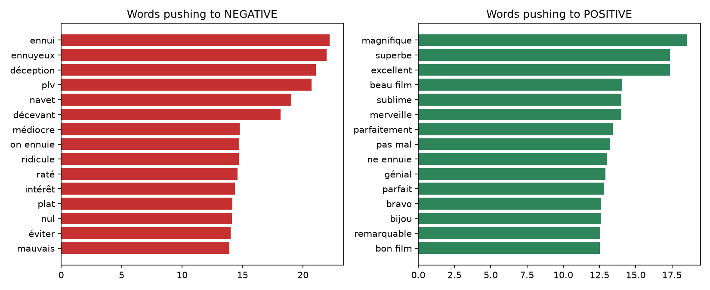
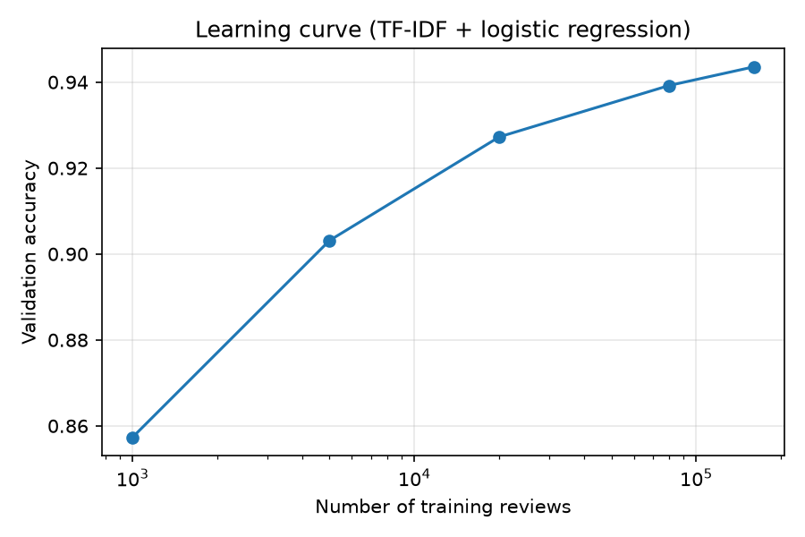

# Sentiment Analysis of French Movie Reviews (Allocine)

[](https://github.com/BilalBess/french-movie-reviews-nlp/actions/workflows/ci.yml)

Classify **200,000 French movie reviews** as positive or negative with classic NLP (TF-IDF + linear models), then study *where and why* the model fails.

## Why this project
Before using a big transformer, a good data scientist should know how far a simple, fast and explainable baseline can go. Here the final model trains in under a minute and reaches **94.7% test accuracy**.

## Data
Allocine dataset (Hugging Face `tblard/allocine`): 160,000 train / 20,000 validation / 20,000 test reviews, labels balanced (about 50% positive). Reviews are about 90 words on average.

## Method
1. **Cleaning**: lowercase and URL removal only. I kept accents, punctuation and stop words, because words like "pas" or "ne" matter for sentiment.
2. **Features** (fit on train only): TF-IDF on word 1-2 grams, and optionally TF-IDF on character 2-5 grams (robust to typos and spelling variants).
3. **Models** compared on the **validation** set: majority class, Naive Bayes, logistic regression, linear SVM, linear SVM with word + char features.
4. The best model on validation is evaluated **once** on the test set.
5. **Error analysis**, most influential words, and a **learning curve**.

## Results
| Model | Validation accuracy | F1 |
|---|---|---|
| Majority class | 0.490 | 0.658 |
| Naive Bayes (words) | 0.927 | 0.926 |
| Logistic regression (words) | 0.944 | 0.943 |
| Linear SVM (words) | 0.945 | 0.944 |
| **Linear SVM (words + chars)** | **0.946** | **0.946** |

**Test set: accuracy 0.9465, F1 0.9445** (574 false positives, 496 false negatives out of 20,000).

The differences between the three best models are small (0.2 points), so the choice between them is not very important. The big jump is from Naive Bayes to a discriminative model (+1.7 points).

### Most influential words (logistic regression)
- **Negative**: *ennui, ennuyeux, déception, navet, décevant, médiocre, ridicule, raté, nul, éviter, daube*...
- **Positive**: *magnifique, superbe, excellent, sublime, merveille, génial, bijou, remarquable, émouvant*...
- Interesting: the **bigrams** *"pas mal"* and *"ne ennuie"* (from "ne m'ennuie pas") are positive, while the single word *ennui* is negative. Using 1-2 grams lets the model handle simple negations.



### Learning curve
| Training reviews | 1,000 | 5,000 | 20,000 | 80,000 | 160,000 |
|---|---|---|---|---|---|
| Validation accuracy | 0.857 | 0.903 | 0.927 | 0.939 | 0.944 |

With 5,000 reviews we already get 90%, and doubling the data from 80k to 160k gives only +0.4 points. More data helps less and less; a better model type would be the next lever.



### Error analysis
- **Review length has little effect**: accuracy is between 93.7% (under 20 words) and 95.0% (20-50 words). Very short reviews are slightly harder, there is less information.
- **Negation words**: accuracy is the same with or without "pas / jamais / plus" (94.6% vs 94.7%). So my simple negation check does not show a weakness. The model is not obviously broken by negation, but it also does not "understand" it: this test is crude.
- **The most confident errors are mostly label noise, not model errors.** Reading the 10 most confident mistakes: reviews like *"Vraiment superbe !! ... époustouflant"* are labelled negative, and *"Un film si mauvais ... tout est raté"* is labelled positive. Some are even marked as fake reviews. This means there is a ceiling on the real accuracy and that the remaining 5% includes labels that are wrong or ambiguous (reviews with a good text but a low grade, or the opposite).

## Limitations
- Bag-of-words ignores word order beyond 2-grams, irony and context ("J'ai été très déçu... car il avait tout pour être bon" is mixed). A fine-tuned French transformer (CamemBERT) would probably gain 1-3 points, but I did not run it here, so I cannot give a number.
- The labels come from user grades, which are noisy.
- Domain shift: a model trained on movie reviews will do worse on restaurant or product reviews.
- Accuracy is computed on one test set, with no confidence interval (about +/- 0.3 points for 20,000 samples).

## How to run
```bash
pip install -r requirements.txt
python src/run.py      # downloads about 75 MB, takes about 10 minutes (char n-grams are slow)
```

## Tests
```bash
pip install pytest
pytest -q
```
The tests cover the text cleaning and that bigrams can capture a simple negation. They run on every push with GitHub Actions (`.github/workflows/ci.yml`: lint with ruff, then pytest).

## Skills shown
Text preprocessing, TF-IDF, n-grams, model comparison with a proper validation/test protocol, learning curves, qualitative error analysis, spotting label noise.
